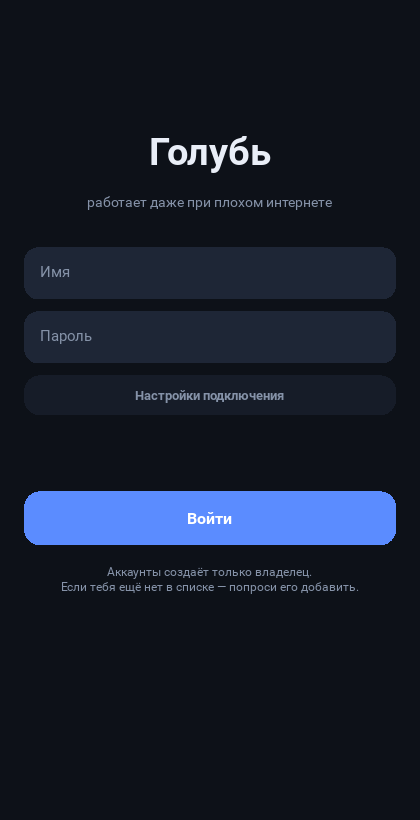
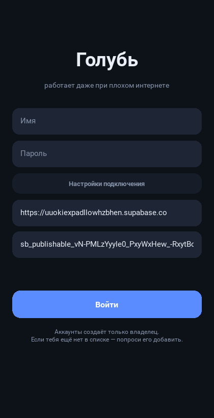
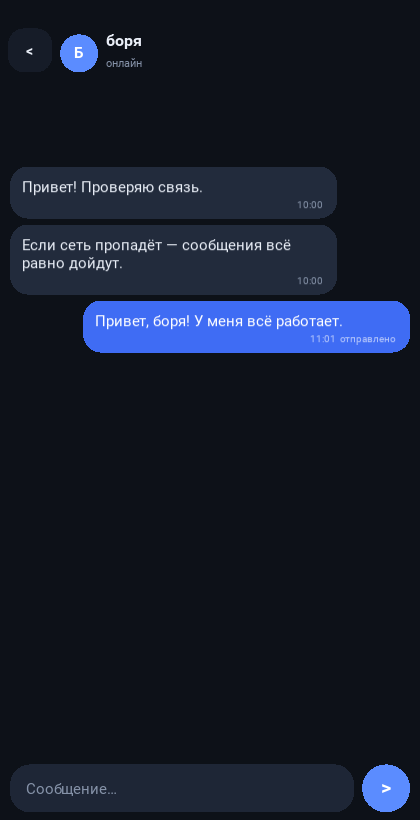
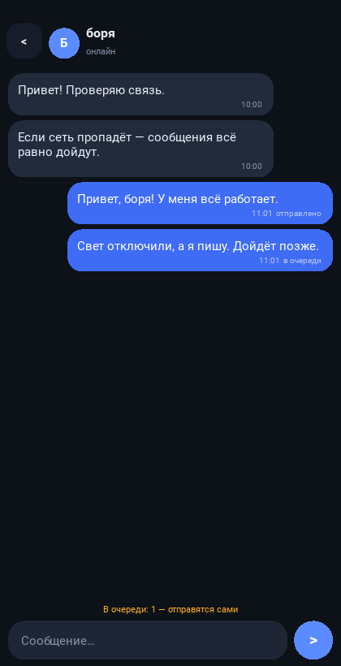
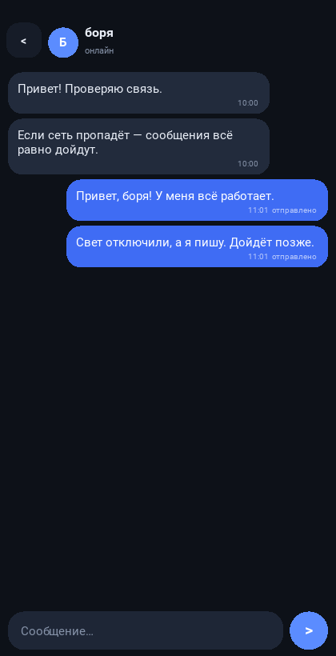

# 🕊 Голубь — мессенджер, который переживает плохой интернет

Приложение на **Python/Kivy** под Android. Своего сервера нет — всё хранится в
**Supabase**, поэтому «свет отключили» приложению не страшно: оно живёт в
интернете, а сообщения, написанные без связи, ждут в памяти телефона и уходят
сами, когда сеть появляется.

**Аккаунты создаёшь только ты.** Регистрация в приложении закрыта: посторонний
не может завести себе вход, даже зная адрес и ключ проекта.

| Вход | Настройки подключения | Чаты |
|---|---|---|
|  |  |  |

| Переписка | Интернета нет — в очереди | Сеть вернулась — ушло само |
|---|---|---|
|  |  |  |

Проект Supabase уже прописан в приложении:

* адрес — `https://uuokiexpadllowhzbhen.supabase.co`
* ключ — `sb_publishable_vN-…` (публичный, его не страшно держать в приложении)

---

## Что сделать один раз (15 минут)

### 1. Создать таблицы в базе

Панель Supabase → твой проект → **SQL Editor** → **New query** → вставь весь
файл [`supabase/schema.sql`](supabase/schema.sql) → **Run**.

Он создаёт таблицы `profiles`, `messages`, `reads`, правила доступа (RLS) и
триггер, который сам заводит профиль новому пользователю. Запускать можно
повторно — ничего не сломается.

### 2. Закрыть самостоятельную регистрацию ⚠️

Панель → **Authentication** → **Sign In / Providers** → **Email** →
выключи **«Allow new users to sign up»** → Save.

Без этого шага любой, у кого есть публичный ключ из приложения, теоретически
мог бы создать себе аккаунт через API Supabase. С выключенным пунктом — не может.

### 3. Создать аккаунты

Два способа — любой на выбор.

**Способ А (удобный): скрипт `admin.py` со своего компьютера.**

1. Панель → **Settings** → **API Keys** → **Secret keys** → скопируй
   `sb_secret_...` (это секретный ключ, он нужен только тебе и только здесь).
2. На компьютере, в папке `golub`:

```bash
export SUPABASE_SECRET_KEY=sb_secret_твой_ключ

python3 admin.py check                      # проверить подключение
python3 admin.py add петя --name "Петя"     # спросит пароль (не отображается)
python3 admin.py add настя --name "Настя"
python3 admin.py list                       # кто есть
python3 admin.py passwd петя                # сменить пароль
python3 admin.py remove петя                # удалить вместе с перепиской
```

Секретный ключ используется только этим скриптом, никуда не сохраняется и
**никогда не попадает в приложение или на GitHub**.

**Способ Б: вручную в панели.** **Authentication** → **Users** → **Add user** →
Create new user: почта вида `петя@golub.local` (имя латиницей или кириллицей —
как удобно), пароль, галочка **Auto Confirm User**. Имя для входа — часть
почты до `@`.

### 4. Собрать APK (компьютер не нужен)

1. Выложи папку `golub` в свой репозиторий на GitHub.
2. Вкладка **Actions** → слева **«Собрать APK «Голубь»»** → **Run workflow**.
3. Через 25–40 минут: внизу запуска **Artifacts → golub-apk** — скачай архив,
   внутри `golub-1.0.0-arm64-v8a-debug.apk`.

Скинь APK на телефон, открой, разреши установку из этого источника.
Появится иконка **Голубь**.

### 5. Войти

В приложении — только **имя** и **пароль** (те самые, что ты создал).
Если понадобится другой проект Supabase — «Настройки подключения» на экране
входа, там же меняются адрес и публичный ключ.

---

## Как это переживает плохой интернет

1. **Пишем в любом состоянии.** Сообщение сначала сохраняется в память
   телефона и в очередь отправки — сеть в этот момент не нужна вообще.
2. **Повторяем сами.** Попытки идут по нарастающей: 1, 2, 3, 5, 8, 13, 20, 25,
   30 секунд — бесконечно, пока не получится.
3. **Никаких дублей.** У каждого сообщения свой номер (uuid), а в базе на нём
   стоит ограничение уникальности. Повтор после обрыва не создаёт копию —
   база отвечает «уже есть», и клиент считает сообщение доставленным.
4. **Догоняем пропущенное.** У сообщений в базе сквозной номер. После
   восстановления связи клиент запрашивает всё, что новее последнего
   известного номера, — ничего не теряется, даже если телефон был выключен
   неделю.
5. **Терпим «тихий» обрыв.** Мобильный интернет часто умирает без разрыва
   соединения. Клиент опрашивает базу каждые 3 секунды с коротким таймаутом:
   нет ответа — считаем сеть пропавшей, а сообщения копятся в очереди.
6. **Крошечный трафик.** Только текст, только JSON, только новое. Один запрос —
   сотни байт. Работает на EDGE, в поезде и на «одной палочке».
7. **Запас на телефоне.** Если в сборке Python для Android вдруг не окажется
   SQLite, приложение автоматически перейдёт на JSON-файл — отправка и история
   продолжат работать.

---

## Файлы

```
golub/
├── client/
│   ├── main.py                интерфейс на Kivy (Android + ПК)
│   ├── supabase_core.py       ★ вся логика плохого интернета и работа с Supabase
│   ├── supabase_settings.py   адрес и публичный ключ проекта
│   ├── storage.py             локальная база: история + очередь (SQLite/JSON)
│   ├── buildozer.spec         настройки сборки APK
│   └── assets/icon.png        иконка
├── supabase/schema.sql        таблицы, правила доступа, триггер профилей
├── admin.py                   ★ создание/смена пароля/удаление аккаунтов
├── tests/
│   ├── mock_supabase.py       локальная заглушка Supabase для тестов
│   ├── test_supabase_core.py  10 тестов: обрывы, перезапуск, дубли, вход
│   └── test_admin.py          8 тестов: аккаунты, пароль, удаление, ключ
├── tools/ui_smoke.py          автотест интерфейса + скриншоты без монитора
└── .github/workflows/         сборка APK в облаке
```

## Запустить на компьютере (без телефона)

```bash
pip install kivy
cd client && python3 main.py
```

Два окна = два аккаунта. Для работы нужны выполненные шаги 1–3 выше.

## Тесты

```bash
cd golub
python3 -m unittest discover -s tests -v
```

18 тестов на настоящем HTTP и локальной заглушке Supabase:

* сообщение без интернета доходит, когда сеть возвращается;
* **закрыл приложение без сети**, открыл позже — сообщение всё равно ушло;
* три обрыва подряд — ни потерь, ни дублей;
* собеседник был офлайн — докачал всё, непрочитанные посчитаны верно;
* отметка «прочитано» доходит до собеседника;
* чужой человек не может зарегистрироваться сам;
* неверный пароль — вход отклонён, попытки не крутятся вечно;
* `admin.py`: создание аккаунта, занятое имя, короткий пароль, смена пароля,
  удаление, отказ при неверном секретном ключе;
* запасное JSON-хранилище ведёт себя как SQLite и переживает перезапуск.

Интерфейс: `python3 tools/ui_smoke.py` — поднимает заглушку, входит в
приложение, шлёт сообщения, «выключает интернет» и делает скриншоты.

---

## Если что-то не так

**В статусе «в базе нет таблиц — выполни supabase/schema.sql»**
Не выполнен шаг 1. Открой SQL Editor и запусти `supabase/schema.sql`.

**«Неверное имя или пароль»**
Аккаунт создаёт только владелец. Проверь `python3 admin.py list` — есть ли там
это имя. Помни: имя входа — это часть почты до `@`.

**«Ключ не подошёл»**
В «Настройках подключения» на экране входа должен стоять **публичный** ключ
(`sb_publishable_...`), а не секретный.

**Приложение пишет «нет сети», хотя интернет есть**
Проверь адрес проекта (должен начинаться с `https://` и оканчиваться
`.supabase.co`) и что проект не на паузе. Бесплатные проекты Supabase
засыпают после недели полного простоя — если мессенджером не пользоваться
7 дней, зайди в панель и нажми Restore. Пока приложением пользуются, оно
само отмечается в сети и проект не засыпает.

**Уведомления с задержкой**
Настройки телефона → Приложения → Голубь → Батарея → **Без ограничений**,
и разреши уведомления.

---

## Честно о безопасности и ограничениях

* Публичный ключ в приложении — так и задумано Supabase: он даёт доступ только
  к тому, что разрешено правилами RLS. **Секретный** ключ (`sb_secret_...`)
  в приложение не попадает никогда.
* RLS: каждый видит только свои переписки; отправить сообщение можно только от
  своего имени; читать и удалять чужие сообщения нельзя.
* Регистрация закрыта, поэтому посторонний не заведёт себе вход. Но если
  кто-то получит имя и пароль — он войдёт. Пароли делай длинные, `admin.py`
  не принимает короче 8 символов.
* Сообщения лежат в базе Supabase (это их серверы) и **не** имеют сквозного
  шифрования: владелец проекта видит их в панели. Для «для своих» это
  нормально; для строгой секретности нужен отдельный слой шифрования — можно
  добавить позже.
* Бесплатный тариф Supabase: 500 МБ базы и 5 ГБ трафика. Текстовых сообщений
  туда влезет очень много (миллионы).

## Что можно добавить дальше

Картинки и голосовые с докачкой по частям, групповые чаты, «печатает…»,
удаление сообщений, сквозное шифрование, push-уведомления через FCM.
Ядро (`supabase_core.py`) не зависит от интерфейса — расширять удобно.
